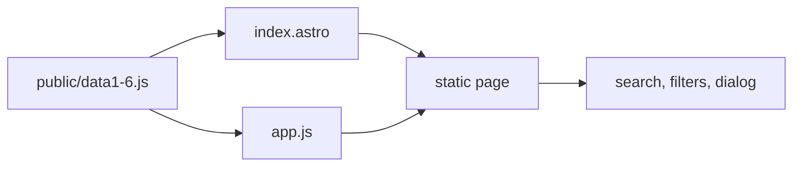

<div align="center">

# Human Skills

**A registry of every skill humanity has mastered — 1,065 skills across 19 domains and 6 eras.**

[](https://adineo-cmd.github.io/human-skills/)
   

[](https://github.com/adineo-cmd/human-skills/stargazers) [](https://github.com/adineo-cmd/human-skills/commits)

[Live site](https://adineo-cmd.github.io/human-skills/) · [Quick start](#quick-start) · [How it works](#how-it-works) · [Features](#features)

</div>

---

A skills.sh-style directory, but for humans: from fire-making to prompt
engineering, each skill carries a description, its era, an order-of-magnitude
practitioner count and a difficulty rating.

Static, searchable and free of tracking.

## Features

| | Feature | What it does |
| --- | --- | --- |
| 🗂️ | **1,065 skills** | Nineteen domains, six eras, one comparable data shape. |
| 🎓 | **Where to learn it** | 1,505 resources merged from the Skills Repository — a description and a learning link per skill, in the Learn tab. |
| 🕰️ | **Era filter** | Ancient through Emerging, with accent colour encoding the era. |
| 📊 | **Practitioner scale** | Order-of-magnitude living-practitioner estimates per skill. |
| ⌨️ | **Keyboard-first search** | Press `/`, filter by domain or era, sort and open a detail dialog. |

## How it works

The site is a static Astro shell over six data files:

1. `public/data1.js` … `data6.js` hold eras, domains and skills.
2. Each skill is `[name, description, era, practitionersLog10, difficulty]`.
3. `src/pages/index.astro` renders the shell; the client script handles search,
   filters, sort tabs, sparklines and the detail dialog.
4. The whole thing builds to static files.



## Quick start

**Install and run**

```bash
npm install
npm run dev
```

**Production build**

```bash
npm run build
npm run preview
```

## Project structure

```text
src/pages/index.astro  page shell
public/data1-6.js      skill and domain data
public/data_learn.js   merged learning resources
public/app.js          search, filters, sort, dialog
public/styles.css      hearth-lit theme
```

## Deployment

Every push to `main` builds the site and deploys it to GitHub Pages
through `.github/workflows/deploy.yml`:

**https://adineo-cmd.github.io/human-skills/**

## Data format

Each skill is `[name, description, era, practitionersLog10, difficulty]`:

- **era** — 0 Ancient · 1 Classical · 2 Medieval · 3 Industrial · 4 Modern · 5 Emerging
- **practitionersLog10** — order of magnitude of living practitioners (9.95 ≈ 8.9 billion)
- **difficulty** — 1 Novice … 5 Master

Practitioner counts are living-population estimates, deliberately rounded.
